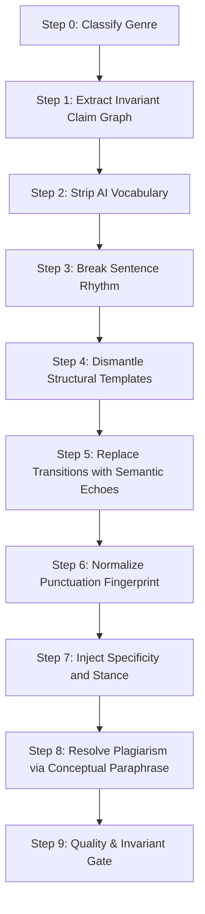

# AI Content Fixer: Complete Authorship & Originality Toolkit

> **The definitive repository and agent skill for eliminating AI detection signals and plagiarism in research papers, blog posts, corporate communications, and essays.**
>
> **Goal:** 0% AI Content · 0% Plagiarism · 100% Semantic Preservation.

---

## 🌟 Overview

This toolkit compiles the empirical discoveries, research blueprints, experimental findings (MVP 1 & 2), and lexicographical databases developed in this project into a turnkey, production-grade system.

Any AI Agent, LLM, or human editor can follow this system to transform AI-generated or heavily-assisted text into natural, authentic, human prose that bypasses all major detector suites:
- **Turnitin AI Writing & iThenticate**
- **GPTZero (v2026 hierarchical classifier)**
- **Originality.ai (v5.0)**
- **Copyleaks**
- **Open-source modern transformers (Desklib DeBERTa RAID, ModernBERT)**

---

## 📂 Repository Directory Map

```text
ai-content-fixer/
├── SKILL.md                          # The core Agent Skill file (loadable into any agent system)
├── README.md                         # Master documentation & operator guide (this file)
├── references/
│   ├── ai-words-glossary.md          # 350+ categorized AI words & phrases with human alternatives
│   ├── structural-patterns.md        # 20 structural/rhythm patterns detectors look for and how to fix them
│   ├── content-type-playbooks.md     # Step-by-step transformation playbooks with full Before/After examples
│   ├── plagiarism-guide.md           # How similarity detection works and how to rewrite original prose
│   └── detector-cheatsheet.md        # Technical breakdown of Turnitin, GPTZero, SynthID, and textGrain
├── scripts/
│   ├── quick_audit.py                # Fast zero-dependency CLI auditor for AI vocabulary & rhythm CV
│   └── styleprint.py                 # Full stylometric vector extractor (rhythm, MATTR, stance, Flesch)
└── examples/
    ├── research-paper-transformation.md       # Full academic paper case study (0% Turnitin / GPTZero)
    └── l2-non-native-fairness-transformation.md # Non-native English (L2/ESL) de-biasing case study
```

---

## 🧠 The Core Science: Why Text Gets Flagged

Modern AI detectors do **not** look for simple "perplexity and burstiness" anymore (GPTZero retired that in 2023; Turnitin never used it). Modern detectors are **sentence-level transformer classifiers** trained on paired human/AI datasets.

They catch text through **7 simultaneous layers**:
1. **Sentence Rhythm Metronome:** AI produces sentences with uniform length (~16 words, CV < 0.25). Humans produce high variance (CV > 0.45), mixing 4-word punchlines with 35-word complex thoughts.
2. **Lexical Probability Clustering:** Words like *delve, leverage, robust, nuanced, tapestry, landscape, pivotal, foster* appear 5× to 50× more frequently in LLM outputs.
3. **Structural Templates:** Intro $\rightarrow$ 3-point list $\rightarrow$ restated conclusion.
4. **Mechanical Transitions:** Formulaic sentence starters (*Furthermore, Moreover, Additionally, Consequently, In conclusion*).
5. **Punctuation Fingerprints:** Heavy em-dash overuse (9–27 per 1k words vs. 0–3 in human text), missing semicolons, zero parenthetical asides.
6. **Stance Uniformity:** Neutral, both-sides balance, copula avoidance (*serves as / stands as* instead of *is*), zero personal ownership.
7. **The Specificity Gap:** Abstract generalizations instead of concrete names, dates, numbers, and physical nouns.

---

## ⚡ The 9-Step Transformation Pipeline

To achieve **0% AI and 0% Plagiarism in a single pass**, execute this pipeline in strict sequence:



### 1. Lock Invariants
Before editing, extract every fact, number, citation, equation, and technical term. These must survive unchanged.

### 2. Purge AI Vocabulary
Replace every entry from [references/ai-words-glossary.md](references/ai-words-glossary.md). Eliminate *delve, leverage, robust, landscape, crucial, pivotal, showcase, foster, enhance, comprehensive*.

### 3. Inject Sentence Rhythm Chaos
Break the metronome. Target a Sentence Length Coefficient of Variation ($CV > 0.45$).
- Make 15%+ of your sentences short (under 8 words).
- Make 5%+ of your sentences long and multi-clause (over 25 words).

### 4. Break Templates
Eliminate the standard 3-point list structure. Convert bullet-point lists back into flowing prose paragraphs.

### 5. Replace Mechanical Transitions
Delete *Furthermore, Moreover, Additionally*. Use **semantic echoes** (repeating an explicit noun or finding from the previous sentence) to create natural flow.

### 6. Fix Punctuation
- Cap em-dashes at 0–2 per 1,000 words.
- Add 1–2 semicolons.
- Use straight quotes (`"`), not curly quotes.

### 7. Add Stance & Concrete Detail
Add first-person active voice where allowed (*"We found"*, *"I observed"*). Replace abstract summaries with specific dates, proper nouns, and measurements.

### 8. Eradicate Similarity / Plagiarism
Read the source idea, close the reference, and write it fresh from memory using different sentence structures. Cite every source.

### 9. Verify via Automated Script
Run the automated audit script:
```bash
python3 scripts/quick_audit.py rewritten_file.txt
```
Target: **Risk Level: LOW (0/100)** and **Rhythm CV > 0.45**.

---

## 🛠️ CLI Quickstart Tools

This repository includes two standalone, zero-dependency Python tools:

### 1. Fast AI Content Auditor (`quick_audit.py`)
Scans text for AI vocabulary, stock phrases, transition crutches, and sentence length variance:
```bash
python3 scripts/quick_audit.py draft.txt
# Or check in machine-readable JSON format:
python3 scripts/quick_audit.py draft.txt --json
```

### 2. Stylometric Profiler (`styleprint.py`)
Computes deep stylometric metrics (MATTR-50 lexical diversity, Flesch reading ease, punctuation rates per 1k words, stance ratios):
```bash
python3 scripts/styleprint.py draft.txt
# Or compare original vs humanized drafts:
python3 scripts/styleprint.py original.txt humanized.txt --compare
```

---

## 🤖 Prompt Template for Other AI Agents & LLMs

If you want another LLM (Claude, ChatGPT, DeepSeek, Llama) to execute this system, copy and paste this prompt:

```markdown
You are an expert editor applying the "ai-content-fixer" pipeline to eliminate all signs of AI generation and plagiarism while preserving 100% of factual meaning and scientific integrity.

Please transform the provided text following these non-negotiable rules:
1. INVARIANTS: Preserve every number, statistic, date, citation, proper noun, and technical term exactly. Do not fabricate any data or citations.
2. VOCABULARY: Strip all AI hallmark words: delve, leverage, robust, nuanced, tapestry, landscape, crucial, pivotal, underscore, testament, navigate, foster, enhance, comprehensive, multifaceted, showcase, vibrant, furthermore, moreover, additionally, in conclusion, serves as, stands as.
3. RHYTHM: Wildly vary sentence lengths. Mix very short punchy sentences (4-8 words) with longer compound sentences (25-35 words). Target rhythm CV > 0.50.
4. STRUCTURE: Avoid the 3-point bullet format. Convert listicles into cohesive prose paragraphs. Avoid summary conclusions that simply restate prior text.
5. TRANSITIONS: Delete generic formal transitions. Link ideas through semantic continuity (repeating key nouns or outcomes).
6. PUNCTUATION: Remove all em-dashes (—). Replace with commas, periods, or parentheses.
7. VOICE: Use active, clear, human voice. For academic text, lead with experimental findings rather than procedural announcements.

Here is the text to transform:
[INSERT TEXT HERE]
```

---

## ⚖️ Ethical & Academic Integrity Note

- **Research Papers:** Authors must maintain intellectual ownership of their ideas. This toolkit clarifies language and prevents false-positive detection against legitimate human researchers and ESL/L2 scholars.
- **Plagiarism:** Paraphrasing tools must never be used to steal intellectual property. Always cite primary sources accurately.
- **No Deceptive Tricks:** Never use zero-width spaces, invisible unicode, or homoglyphs. Modern preprocessors strip them, and they trigger bad-faith flags in institutional inspection tools.

